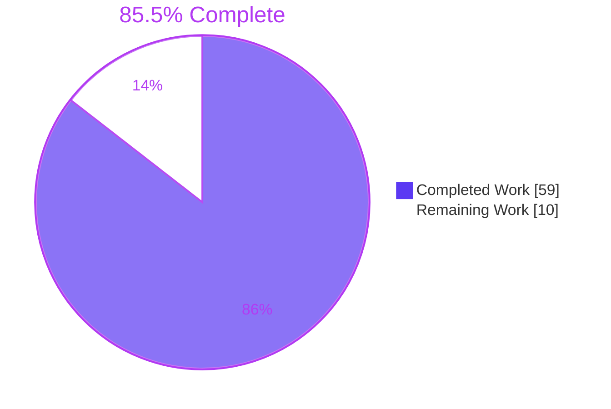
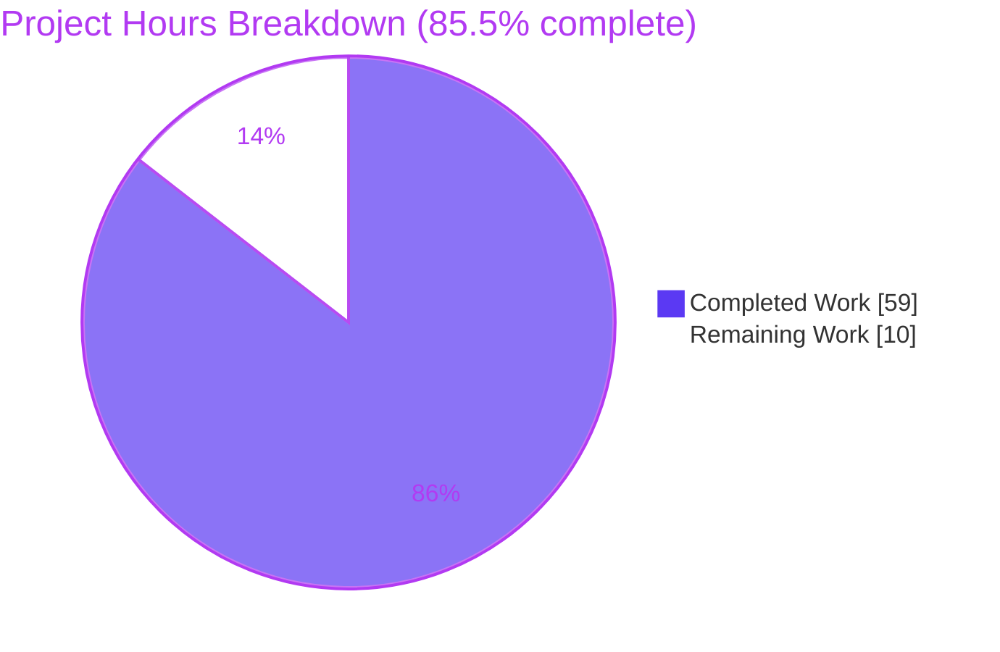
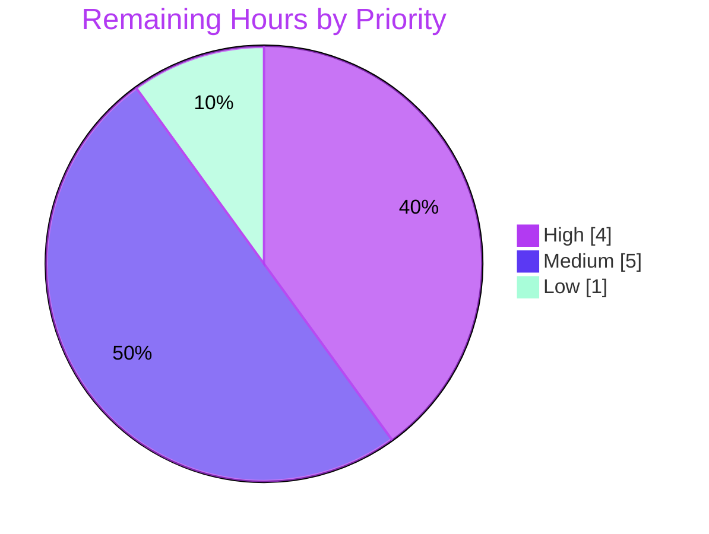

# 1. Executive Summary

## 1.1 Project Overview

`nodejs-tutorial-hello-world` is a zero-dependency Node.js HTTP server for beginners learning HTTP without a framework. It ships as exactly three root files: `server.js`, `package.json` and `README.md`. `GET /hello` returns `Hello world`, and every other method and path, including `CONNECT`, returns `404 Not Found`. Every request is logged. `PORT` (1024–65535, default 3000) is validated before binding, and bind failures exit 1 with an actionable message. CTRL+C shuts the server down with exit 0 once in-flight responses finish. The README takes a reader with no prior knowledge from install to shutdown.

## 1.2 Completion Status



| Metric | Hours |
|---|---|
| Total Hours | 69 |
| Completed Hours (AI + Manual) | 59 (AI 59, Manual 0) |
| Remaining Hours | 10 |
| Percent Complete | **85.5%** |

Calculation: 59 completed hours ÷ (59 + 10) total hours = 59 ÷ 69 = **85.5% complete**.

## 1.3 Key Accomplishments

- ✅ Exactly three deliverables, with no dependencies, lockfile or extra files
- ✅ An exact HTTP contract: 200 `Hello world` (11 bytes), 404 `Not Found` (9 bytes), explicit `Content-Length`
- ✅ `CONNECT` answered with a byte-exact raw 404, after earlier pipelined responses, and never tunnelled
- ✅ `PORT` validation with the four exact AAP messages; ports 0–1023 are refused before `listen()`
- ✅ Graceful shutdown: idle connections close in about 8 ms, owed output arrives whole, and the 5 s fallback fires at 5010 ms
- ✅ P1 maximum of 1.21 ms against the 10 ms bar; memory growth of at most 3.7 MiB against 5 MiB
- ✅ All 16 README expected-output blocks match real runs
- ✅ The full AAP 0.12 gate suite passes on Node v24.22.0 and v22.23.3

## 1.4 Critical Unresolved Issues

5 items are open. They touch 4 of the 12 deliverables in Section 5.1: two verification gaps (deliverables 9 and 10) and three runtime caveats that were accepted rather than fixed (deliverables 3, 7 and 10). None of them blocks use on Node 22 or 24.

| Issue | Impact | Owner | ETA |
|---|---|---|---|
| The gates have never run on the Node v18.0.0 binary that `engines.node` promises (Section 5.2, divergence 1) | The `>=18.0.0` claim, including the shutdown call at `server.js:263`, is proven only statically | Maintainer | 4 h |
| The Windows and macOS README steps have not been executed (PowerShell, Command Prompt, zsh, folder drag) | A beginner on those platforms may hit an undocumented difference | Maintainer | 3 h |
| When file descriptors run out, the server keeps running silently instead of exiting 1 (divergence 6) | It stops serving and logs nothing. `README.md:308` documents this | Product owner | Accept in review |
| A `CONNECT` whose reply waits behind an unread earlier response has no close timer | One client can hold one socket until shutdown | Product owner | Accept in review |
| `engines.node >=18.0.0` admits end-of-life 18.x runtimes that carry HTTP/1 parser CVEs | The deployment's security depends on the runtime chosen. The README recommends the current LTS | Product owner | Accept in review |

## 1.5 Access Issues

| System/Resource | Type of Access | Issue Description | Resolution Status | Owner |
|---|---|---|---|---|
| Node.js v18.0.0 binary (nodejs.org/dist) | Runtime installation | The validation host does not allow Node below 20.20.2 or 22.12.0, so no gate could run on the declared floor | Open: needs a host that allows it | Maintainer |
| Windows 10/11 and macOS machines | Test platforms | Only Linux was available. The Windows shell commands and the macOS-specific README text were checked by reading only | Open | Maintainer |

## 1.6 Recommended Next Steps

1. [High] Run the AAP 0.12 gates on the official Node v18.0.0 / npm 8.6.0 binaries (Section 9.6).
2. [Medium] Walk through `README.md` on Windows (PowerShell, Command Prompt) and on macOS (zsh).
3. [Medium] Accept the eight Section 5.2 divergences and the three accepted caveats.
4. [Medium] Code-review and merge the branch.
5. [Low] Re-run P1–P3 on an unloaded machine.

# 2. Project Hours Breakdown

## 2.1 Completed Work Detail

| Component | Hours | Description |
|---|---|---|
| Configuration and startup (FR5, FR6) | 4 | `resolvePort` with the digits-only check, the 1024–65535 range and the four exact messages; an entry block that never creates a server for an invalid `PORT`; the startup line written in the `listen` callback (`server.js:18–48`, `294`, `301–307`) |
| Request pipeline (FR1–FR4) | 5 | Query-free path scan, ISO-8601 request log, `sendText` with explicit `Content-Length`, `handleHello`/`handleNotFound`, `Map` route table, dispatch inside `try/catch` (`server.js:51–109`) |
| Error handling (FR8, FR9) | 4 | Handler-error backstop (500, or a destroyed response if headers were already sent), safe for non-Error throws; EADDRINUSE, EACCES and generic server-error messages leading to exit 1 (`server.js:112–129`, `200–212`) |
| Protocol edge cases (0.5.3) | 7 | `CONNECT` rejection with a raw 404, a silent `'error'` listener, the reply deferred behind pipelined responses and an unref'd close timer; requests with an `Expect` header routed through the normal pipeline (`server.js:156–197`, `289`) |
| Graceful shutdown (FR7, 0.5.5) | 10 | Connection and response tracking, `closeWhenFlushed` with its `'finish'` re-check, a listener-only close that avoids Node ≥19's idle sweep, a 5 s unref'd fallback, a sticky exit-1 status, and `process.once('SIGINT')` (`server.js:132–153`, `214–275`, `297`) |
| Code quality and API-floor conformance (0.4.2, 0.11) | 2 | Units in the AAP 0.5.1 order, one-line responsibility comments, `const` only, own-line comments, LF endings, a single `require('node:http')` |
| `package.json` manifest (FR10) | 1 | Exactly seven fields in canonical `JSON.stringify(…, null, 2)` layout, `engines.node` `>=18.0.0`, no dependencies |
| `README.md` beginner guide (FR11) | 10 | 320 lines with 7 sections, expected output after every command, Windows/macOS/Linux variants, and nine troubleshooting entries |
| Validation and acceptance (0.12) | 16 | AAP gates F1–F6, P1–P3, C1–C3, D1–D3 and S1–S3 on two runtimes; README walkthrough; security, robustness and performance probes; a v18 API-surface proxy |
| **Total** | **59** | |

## 2.2 Remaining Work Detail

| Category | Hours | Priority |
|---|---|---|
| [AAP 0.12] Run every gate on the official Node v18.0.0 / npm 8.6.0 binaries and confirm the floor-compatible shutdown path | 4 | High |
| [AAP 0.12.4 D1] Walk through the README on Windows (PowerShell 5.1 with `curl.exe`, Command Prompt) and macOS (zsh, Finder) | 3 | Medium |
| [Path-to-production] Review and accept the Section 5.2 divergences and the three accepted runtime caveats | 1 | Medium |
| [Path-to-production] Maintainer code review and merge of the three-file change | 1 | Medium |
| [AAP 0.12.2] Re-run P1–P3 on an unloaded host to confirm the 10 ms bar without contention outliers | 1 | Low |
| **Total** | **10** | |

## 2.3 Hours Calculation and Confidence

- Total = 59 completed + 10 remaining = **69 hours**. Completion = 59 ÷ 69 = **85.5%**.
- Completed hours are sized from the delivered code (307 lines of `server.js`, 320 of `README.md`, 19 of `package.json`) and from the breadth of the verification run against it. Confidence: high.
- Remaining hours are confidence-weighted:
  - The v18.0.0 run is medium confidence. A behaviour difference on the floor binary would add debugging time, which is why it carries a 1.5 h buffer.
  - The cross-platform README walkthrough is medium confidence.
  - The review, merge and performance tasks are high confidence.

# 3. Test Results

The project has no committed test suite: AAP 0.7.1 fixes the deliverable at three files. It is verified with the procedural gates of AAP 0.12, using `node`, `curl` 8.14.1 and bash, against `HEAD` `7bcdbba`. Each server ran in an isolated network namespace on two runtimes, official Node v24.22.0 / npm 11.19.1 and Node v22.23.3 / npm 11.21.0. The gate session ran three times: once on v24 and twice on v22. The README check and the supplementary protocol checks ran once on each runtime. No coverage tool applies, because the zero-dependency mandate excludes one.

| Area / Category | Framework | Tests | Passed | Failed | Coverage | What This Proves |
|---|---|---|---|---|---|---|
| Static and security checks (S3) | `node --check`, AAP grep set | 18 | 18 | 0 | n/a | One `require('node:http')`; no `eval`, `child_process`, `node:fs` or `process.exit()`; no placeholder text; no floor-violating API; `const` only |
| HTTP contract and request log (F1–F5) | AAP gate procedure, curl | 48 | 48 | 0 | n/a | `/hello` returns 200 with 11 bytes; every other method, path and `CONNECT` returns 404; one correctly formatted log line per request, in order |
| Graceful shutdown (F6 a–d) | AAP `probe.js` / `stubborn.js` | 36 | 36 | 0 | n/a | SIGINT gives exit 0; an idle keep-alive connection closes in 6–8 ms; 27,213–41,959 owed responses arrive whole in about 1.4 s; a stubborn client is cut at 5010 ms |
| Performance (P1–P3) | curl `time_total`, `ps` RSS | 27 | 26 | 1 | n/a | 1,000 sequential requests with a maximum of 1.21 ms; 1,000×200 at 50-way concurrency; RSS growth of at most 3,696 KiB. The one failure was P2b at 17.1 ms on the first v22 run, which passed at 0.42 ms on rerun |
| Configuration (C1–C3) | AAP gate procedure | 66 | 66 | 0 | n/a | `PORT=8080` overrides the port; 8 invalid values and ports 0/80/443/1023 give the exact message and exit 1; ports 1024 and 65535 bind |
| Error handling (S1, S2) | AAP gate procedure | 30 | 30 | 0 | n/a | A second instance exits 1 with the exact EADDRINUSE line; a throwing handler returns a 21-byte 500 that exposes nothing, and the server keeps serving |
| Documentation and packaging (D1–D3) | README block diff on a `git archive` copy; D2 one-liner; `setsid npm start` | 57 | 57 | 0 | n/a | All 16 README output blocks match byte for byte (timestamps normalised); the manifest has the seven exact fields in canonical layout; `npm start` runs the server (npm exits 130) |
| Protocol and robustness extras | raw-socket and curl checks | 58 | 58 | 0 | n/a | Edge paths (`/hello/`, `/HELLO`, `/%68ello`, `//hello`, `/a/../hello`) return 404; `Expect: something` follows the normal routes; the raw `CONNECT` reply is byte-exact and ordered after pipelined GETs; CR in the target returns 400; a client reset does not crash the server; a busy port 8080 suggests `PORT=8081`; non-Error throws are contained |

**Totals:** 340 executions, 339 passed, 1 failed. The failure was a single timing outlier, and its gate passed on rerun.

Standalone P2b reruns give more detail on that outlier. With the server warmed up as the gate procedure does, all 16 runs (8 per runtime) finished under 1 ms. On a brand-new server with no warm-up, the first request took 2.8–25 ms on v22, and 2 of 8 runs exceeded 10 ms, with the host load average at 6–9 on 12 cores.

**Not Covered**

- **Node v18.0.0 runtime.** No test has run on the declared floor. Before release, run the whole gate suite on the official v18.0.0 binary with npm 8.6.0 (Section 9.6). This matters most for the listener-only close at `server.js:263` and the `'checkExpectation'` listener at `server.js:289`.
- **Windows and macOS README steps.** PowerShell (`curl.exe`, `$env:PORT`, `Remove-Item Env:PORT`), Command Prompt (`set PORT=8080`, `cd %USERPROFILE%…`, `cd /d`, `Terminate batch job (Y/N)?`), zsh's `%` marker and the Finder/File Explorer folder-drag tip have not been executed. Walk through the README on each platform.
- **Real file-descriptor exhaustion.** The `Server error:` → exit 1 path (`server.js:209–211`) runs only for errors that Node.js emits, and Node 22/24 never emits an accept failure. Confirm that the documented silent behaviour (`README.md:308`) is acceptable.
- **Regression protection.** The repository has no automated suite or CI. Any later edit must be re-verified by re-running the gate procedure.

# 4. Runtime Validation & UI Verification

All of these flows were run against live servers started from the repository root, on Node v24.22.0 and v22.23.3. The product has no graphical interface. In a real Chrome browser, `/hello` renders as plain text, and payloads placed in the request path are never reflected.

- ✅ **Startup:** `node server.js` and `npm start` print `Server listening on port 3000` only after a successful bind. `PORT=8080` moves the listener and leaves port 3000 vacant. Ports 1024 and 65535 bind.
- ✅ **Primary journey:** `GET /hello` returns `200 Hello world`. `/invalid`, `POST /hello`, `HEAD /hello`, `OPTIONS *`, absolute-form targets, `M-SEARCH`, `PUT`, `DELETE` and `PATCH` return `404 Not Found`. Requests carrying `Expect: something` follow the same routes.
- ✅ **CONNECT rejection:** the 99-byte raw 404 is exact. It is sent after the responses to earlier pipelined GETs, and nothing is tunnelled. A client reset leaves the server running with empty stderr. Rejected clients that never close are released within about 6 s: 200 such clients took the descriptor count from 222 back to 22.
- ✅ **Request logging:** one `<ISO-8601> <METHOD> <path>` line per request, query string removed, including `CONNECT localhost:9`. Requests that Node.js rejects (CR, LF or ESC in the target) get a 400 and are not logged, so no forged log line is possible.
- ✅ **Shutdown:** CTRL+C prints `Received SIGINT, shutting down server` and exits 0. Idle keep-alive connections close in 6–8 ms. A pipelined backlog that is still unflushed at SIGINT arrives whole. The 5 s fallback fires at 5010 ms. A second CTRL+C terminates with status 130.
- ✅ **Bind and server errors:** EADDRINUSE and EACCES each print one actionable line, with no stack trace and no startup line, and exit 1. A busy port 8080 suggests `PORT=8081`. An accept error injected into Node's own `net` path prints the `Server error:` line, drains connections and exits 1.
- ✅ **Handler failures:** Error, string, `null`, `undefined`, number, `Object.create(null)`, Symbol and revoked-Proxy throws each produce a fixed 21-byte 500 and one stderr line, and the server keeps serving. A throw after the headers were sent aborts the response instead.
- ✅ **Security boundaries:** a canary listener shows no outbound connection. `strace` shows no file access or process execution during request handling. The query string, headers and body are never read. A 50 MB unread body and request floods leave the server responsive.
- ⚠ **File-descriptor exhaustion:** Node 22/24 absorbs accept failures inside libuv. The server stays up, prints nothing and serves nothing new until descriptors free up. This is documented in `README.md:308`, but it does not exit 1 as AAP 0.5.5's accept-failure row expects.
- ⚠ **Never exercised at runtime:** the Node v18.0.0 binary (only checked with a v18 API-surface shim on v24), and the Windows PowerShell, Command Prompt and macOS zsh/Finder instructions in the README.

# 5. Compliance & Quality Review

## 5.1 Compliance Matrix

| # | AAP Deliverable | Benchmark | Status | Progress |
|---|---|---|---|---|
| 1 | Three-file repository (0.6.1, 0.7) | Only `server.js`, `package.json`, `README.md`; no lockfile, `node_modules`, tests or CI | ✅ PASS | 100% |
| 2 | HTTP contracts (FR1–FR3, 0.5.3) | Exact status, headers and bodies; exact, case-sensitive, undecoded `Map` routing | ✅ PASS | 100% |
| 3 | `CONNECT` rejection (0.5.3) | Logged, byte-exact raw 404, never tunnelled, reset-safe | ✅ PASS (divergence 4) | 100% |
| 4 | Request logging (FR4, 0.5.4) | One ISO-8601 line per request before routing, query string removed | ✅ PASS | 100% |
| 5 | `PORT` configuration (FR5, 0.5.2) | Default only when unset; `^\d+$`; 1024–65535; four exact messages; exit 1 | ✅ PASS | 100% |
| 6 | Startup and graceful shutdown (FR6, FR7, 0.5.5) | Startup line after bind; SIGINT exit 0; idle close; flush; 5 s fallback | ✅ PASS (divergence 2) | 100% |
| 7 | Bind, server and handler errors (FR8, FR9) | One actionable stderr line, exit 1, no internals in any response | ✅ PASS (divergences 5, 6) | 100% |
| 8 | `package.json` (FR10, 0.4.3) | Seven exact fields, canonical layout, `engines.node` `>=18.0.0` | ✅ PASS | 100% |
| 9 | `README.md` (FR11, 0.5.6, D1) | Zero-knowledge guide; every documented output matches a real run | ⚠ PARTIAL: Linux verified; Windows/macOS steps unexecuted | 85% |
| 10 | Node v18.0.0 compatibility (0.1.1 NFR, 0.4.2) | Every API exists in v18.0.0; gates run on the v18.0.0 binary | ⚠ PARTIAL: static and shim evidence only | 75% |
| 11 | Security boundaries and code standards (0.3.2, 0.11) | No eval, fs, child_process, outbound traffic or `process.exit()`; one `require`; `const` only; own-line comments; LF endings | ✅ PASS | 100% |
| 12 | Performance NFRs (0.12.2) | P1 maximum < 10 ms; P2 1000×200 and slow-client < 10 ms; P3 growth ≤ 5120 KiB | ✅ PASS (one rerun after a host outlier) | 100% |

## 5.2 AAP & Rule Divergences and Gaps

AAP 0.9 sets no user rules, so every entry below is a departure from the AAP itself.

| # | What the AAP/Rule Required | What Was Delivered Instead | Why It Diverged | Impact | Remediation |
|---|---|---|---|---|---|
| 1 | Run every 0.12 gate on official Node v18.0.0 and on v24.22.0 | Gates run on v24.22.0 and v22.23.3 | The host's platform restriction forbids installing Node below 20.20.2 or 22.12.0 | The `engines.node` floor is proven only statically | Run the gates on v18.0.0 (4 h, Section 2.2) |
| 2 | `stopServer` calls `server.close()` (0.5.1, 0.5.5) | `Object.getPrototypeOf(http.Server.prototype).close.call(server)` (`server.js:263`) | From Node 19, `http.Server` `close()` sweeps idle connections and cuts off unflushed responses | Whole responses are kept on Node ≥19; v18 path is static only | Confirm in the v18.0.0 run; accept |
| 3 | Four server listeners and the 0.4.2 API table | Fifth listener, `'checkExpectation'`, re-emitting `'request'` (`server.js:289`) | Node otherwise answers non-`100-continue` `Expect` requests with an empty 417 and skips routing | FR1–FR4 hold for every parsed request | Accept |
| 4 | `handleConnect`: log, record, `'error'` listener, end with raw 404 | Same order, plus a deferred reply, a 5 s close timer and a `true` flushed marker (`server.js:160–196`) | An immediate reply overtakes pipelined responses; clients that never close pin descriptors | Correct ordering and bounded sockets; one LOW residual | Accept residual or add a bound |
| 5 | Exact message lines with `PORT=8080` (0.5.4) | Suggests `PORT=8081` when 8080 failed; `Server error:` keeps Node's own message | Repeating the failed port is not actionable; AAP labels these as example values | Port-3000 lines are unchanged | Accept |
| 6 | Accept failure such as EMFILE exits 1 (0.5.5) | Real descriptor exhaustion leaves the server running silently | libuv on Node 22/24 never surfaces accept errors; unit list is fixed | Server can stall without a log line | Accept with README note, or supervise the process |
| 7 | README per the 0.5.6 map, created in an empty repo | Rewrite of the existing two-line README, with extra guidance and a corrected newline note | D1 accuracy (zsh) and the zero-knowledge rule | Better beginner coverage; Windows/macOS text unexecuted | Cross-platform walkthrough (3 h) |
| 8 | Behaviour the AAP left unspecified | Non-Error throws contained; exit 1 kept when CTRL+C follows a server error; `for...of` path scan | Robustness, and staying inside the 0.4.2 inventory | Behaviour verified on both runtimes | None |

**1 — Node v18.0.0 gate runs.** AAP 0.12 and 0.8.2 require every gate to run twice: on the official v18.0.0 binary and on v24.22.0. The validation host does not allow Node below 20.20.2 (20.x) or 22.12.0 (22.x) to be installed, so system v22.23.3 was the second runtime. The v18 floor is upheld by keeping to the AAP 0.4.2 API inventory: `server.js` has no `closeAllConnections`, `closeIdleConnections`, `url.parse` or `new URL`, and a v18 API-surface shim was run on v24. `engines.node` stays `>=18.0.0` (`package.json:9–11`). Until the gates run on v18.0.0, the compatibility promise rests on static evidence. Run Section 9.6 on a host that permits it.

**2 — Listener-only close in `stopServer`.** AAP 0.5.1 and 0.5.5 say `stopServer` "calls `server.close()`". `server.js:263` instead calls the `close()` that `http.Server` inherits from `net.Server`, reached through `Object.getPrototypeOf`, which the 0.4.2 table does not list. From Node 19, `http.Server.prototype.close` first runs `closeIdleConnections()`. That sweep destroys a connection whose response has ended but not yet flushed, which breaks 0.5.5's whole-response guarantee. On v24, a copy calling `server.close()` truncated a 35,200-request pipelined backlog that the delivered call delivers whole. Both APIs exist in v18.0.0, whose `close()` has no sweep. Confirm this in the v18.0.0 run, then accept.

**3 — `'checkExpectation'` listener.** AAP 0.5.1, 0.5.5 and 0.11.1 list four server listeners. `server.js:289` adds a fifth, which re-emits `'request'` through `server.emit`; neither API appears in the 0.4.2 table. Without it, Node answers any HTTP/1.1 request whose `Expect` value is not `100-continue` with an empty 417 and never calls `handleRequest`. Such a request would then get neither the 200 nor the 404 contract, and would not be logged, against FR1–FR4. The header itself is never read. Both APIs exist in v18.0.0 (the event since v5.5.0, `emitter.emit` since v0.1.26). No action is needed beyond accepting the extra listener.

**4 — `CONNECT` lifetime and ordering.** AAP 0.5.1 specifies `handleConnect` as: log, record the socket, attach the `'error'` listener, end with the raw 404. The delivered function keeps that order (`server.js:159–175`) and adds three things. The reply waits for the latest earlier pipelined response to finish, because an immediate raw end would overtake queued responses and lose them. An unref'd `SHUTDOWN_TIMEOUT_MS` timer destroys a rejected socket whose client never closes, which would otherwise pin one descriptor per client. Flushed connections are marked `true` in the tracking map. One residual remains: a reply waiting behind an earlier response the client never reads arms no timer. Accept that, or bound it explicitly.

**5 — Message wording.** AAP 0.5.4 gives the EADDRINUSE and EACCES lines with a literal `PORT=8080` suggestion. `server.js:203–207` suggests `PORT=8081` when the failed port is itself 8080, because repeating the advice would fail the same way. The port-3000 lines, which gate S1 and `README.md:299` quote, are byte-identical to the AAP. The generic line follows the AAP's stated form, `Server error: <error.message>. …`. Because Node's real message is `accept EMFILE`, the AAP's illustrative `accept EMFILE: too many open files` never appears verbatim. No action is needed unless the example text must be reproduced exactly.

**6 — Unreachable accept-failure exit.** The AAP 0.5.5 exit-code table expects an accept failure such as EMFILE to end in exit 1 through `handleServerError`. On Node 22 and 24, libuv never reports accept failures to JavaScript. It drops the queued client and keeps listening, so real descriptor exhaustion leaves the server running and silent. The handler itself is correct: an accept error injected through Node's own `net` path printed the exact line and exited 1. AAP 0.5.1 fixes the list of units, so no descriptor monitor was added. Instead, `README.md:306–308` documents both the `Server error:` case and the silent case, including `ulimit -n`. Decide whether this deployment needs process supervision.

**7 — README scope.** AAP 0.5.6 maps the README content row by row and assumes an empty repository. A two-line placeholder README already existed, so the file was rewritten rather than created. The AAP's own sentence "the prompt appears on the same line" is false in zsh, the macOS default, so `README.md:107` distinguishes bash from zsh. To meet D1's zero-knowledge rule, the guide also adds a favicon note, the Command Prompt trailing-space error, `PORT=8080 npm start`, npm's status 130, the `Terminate batch job` prompt, and troubleshooting entries for the wrong folder, `Server error:`, silent descriptor exhaustion and `Failed to connect`. The Windows and macOS text remains unexecuted.

**8 — Edge cases the AAP left open.** Three behaviours the AAP does not specify were settled in code. `handleRequestError` (`server.js:112–129`) contains thrown values that are not Errors through a template literal, and names the value's type when conversion itself throws. The AAP types the parameter as `Error`, and a thrown `null` would otherwise crash the backstop. `stopServer` keeps exit code 1 when CTRL+C follows a server error (`server.js:256`), as the 0.5.5 exit table implies. `getRequestPath` scans characters with `for...of` (`server.js:56–63`) instead of `indexOf`/`slice`, which the 0.4.2 inventory omits. Each was exercised on both runtimes. No action is needed.

# 6. Risk Assessment

| Risk | Category | Severity | Probability | Mitigation | Status |
|---|---|---|---|---|---|
| Behaviour on the Node v18.0.0 floor differs from v22/v24, for example the listener-only close at `server.js:263` or the `'checkExpectation'` re-emit at `server.js:289` | Technical | Medium | Low | Run the full gate suite on the official v18.0.0 binary (Section 9.6) | Open |
| When descriptors run out, the server stops accepting work without logging or exiting, because libuv absorbs the accept error | Operational | Medium | Low | Documented in `README.md:308`; keep `ulimit -n` adequate, or run under a supervisor that restarts on missing health | Accepted |
| `engines.node >=18.0.0` admits end-of-life 18.x builds that carry HTTP/1 parser CVEs, including CVE-2024-22019 (chunk-extension DoS) and CVE-2022-32213/32214/32215 (request smuggling) | Security | High | Low | Run on the current LTS, as `README.md:17` recommends; never deploy an unpatched 18.x | Accepted |
| Single requests exceed 10 ms under host contention or on a cold server (observed 13–25 ms); a slow stdout can block the event loop through the mandated `console.log` | Technical | Low | Medium | Redirect stdout to a file, as the gates do; confirm P1–P3 on an unloaded host | Open |
| No authentication, rate limiting or TLS, and the listener binds to all interfaces, as the AAP scopes it | Security | Medium | Low | Keep it to local tutorial use; put a reverse proxy in front if it is ever exposed | Accepted (out of AAP scope) |
| A `CONNECT` whose reply waits behind an earlier response the client never reads holds its socket until shutdown | Security | Low | Low | Node's defaults give an unread HTTP response no bound either; add a bound only if exposure grows | Accepted |
| Windows and macOS README commands have not been executed, so a beginner may hit an undocumented difference | Integration | Medium | Medium | Walk through the README on PowerShell 5.1, Command Prompt and macOS zsh | Open |
| The code relies on Node internals (the `http.Server` → `net.Server` prototype chain, `'checkExpectation'` semantics) that a future major release could change | Technical | Low | Low | Re-run the AAP 0.12 gates on each new LTS before upgrading | Monitor |

# 7. Visual Project Status



**Remaining hours by priority (10 h total)**



| Remaining Category (Section 2.2) | Hours | Priority |
|---|---|---|
| Gates on Node v18.0.0 / npm 8.6.0 | 4 | High |
| Windows and macOS README walkthrough | 3 | Medium |
| Divergence and caveat acceptance review | 1 | Medium |
| Code review and merge | 1 | Medium |
| P1–P3 on an unloaded host | 1 | Low |
| **Total** | **10** | |

# 8. Summary & Recommendations

The project is **85.5% complete**: 59 of 69 hours are done and 10 remain. Every deliverable the AAP names is implemented. `server.js` is a single, readable file holding the AAP 0.5.1 units in order. `package.json` carries exactly the seven required fields. `README.md` takes a first-time reader from `node --version` to CTRL+C, with real expected output after every command. No dependency, lockfile or extra file was added.

Verification is thorough on the two runtimes exercised, Node v24.22.0 and v22.23.3. Across 340 executions, the full AAP 0.12 gate suite passes, along with a byte-for-byte check of all 16 README output blocks and 29 supplementary protocol checks per runtime. The only failure was one timing outlier, and its gate passed on rerun. Latency stays around 1 ms against the 10 ms bar, and memory growth is at most 3.7 MiB against a 5 MiB limit. On shutdown, idle connections close in single-digit milliseconds, every owed response arrives whole, and the fallback fires at 5010 ms.

Three gaps remain. First, the `engines.node >=18.0.0` promise has never run on the v18.0.0 binary. It rests on the API inventory and a v18 API-surface shim, which matters most for the listener-only close at `server.js:263`. Second, the README's Windows and macOS instructions have been read but not executed. Third, three runtime caveats were accepted rather than fixed: silent behaviour when file descriptors run out, an unbounded wait for a `CONNECT` queued behind an unread response, and an engine floor that admits end-of-life runtimes. Section 5.2 records eight departures from the AAP text, each with its cause, and each needs sign-off.

The critical path to release has four tasks:
1. Run Section 9.6 on Node v18.0.0 / npm 8.6.0 (4 h). This is the only task that could surface a code change.
2. Walk through the README on Windows and macOS (3 h).
3. Accept the divergences and caveats, then review and merge (2 h).
4. Optionally, confirm P1–P3 on an unloaded machine (1 h).

**Production readiness:** ready for its stated purpose, a local reference server for learners, on Node 22 and 24. It should not be described as verified on Node 18.0.0 until the floor run passes. It is not hardened for internet exposure, which the AAP rules out of scope: there is no TLS, authentication or rate limiting. Release is successful when all 15 validation gates pass on both v18.0.0 and v24.22.0, and every README block matches on each platform.

# 9. Development Guide

## 9.1 System Prerequisites

- **Node.js ≥ 18.0.0.** The current LTS is recommended. Verified with v24.22.0 (npm 11.19.1) and v22.23.3 (npm 11.21.0).
- **curl 7.66.0 or later**, for the request examples and gates. Verified with curl 8.14.1. On Windows PowerShell, call it as `curl.exe`.
- **bash** plus standard tools (`kill`, `wait`, `ps`, `grep`, `awk`, `setsid`), for the validation gates. `ip netns` is optional, for isolated port testing on Linux.
- **Hardware:** one server uses about 60 MB RSS and less than one CPU core.

## 9.2 Environment Setup

The only setting is `PORT`. There is no `.env` file, build step or virtual environment.

```bash
# From the repository root (the folder that contains server.js)
cd /path/to/nodejs-tutorial-hello-world
node --version        # expect v18.0.0 or later
unset PORT            # use the default port 3000
```

## 9.3 Dependency Installation

There are no dependencies. **Do not run `npm install` or `npm ci`.** They would create a `package-lock.json`, which the three-file layout forbids. `npm start` needs no install step.

## 9.4 Application Startup

```bash
# Option 1: Node.js directly (default port 3000)
node server.js
# Expected: Server listening on port 3000

# Option 2: through npm
npm start
# Expected: a blank line, "> nodejs-tutorial-hello-world@1.0.0 start", "> node server.js", a blank line,
# then: Server listening on port 3000

# Custom port (macOS/Linux)
PORT=8080 node server.js
# Expected: Server listening on port 8080
```

Stop the server with CTRL+C. The expected line is `Received SIGINT, shutting down server`, with exit status 0, or 130 when run under `npm start`.

## 9.5 Verification Steps and Example Usage

Run these in a second terminal while the server is running:

```bash
curl http://localhost:3000/hello                 # Hello world   (11 bytes, no trailing newline)
curl -i http://localhost:3000/hello              # HTTP/1.1 200 OK, Content-Type: text/plain, Content-Length: 11
curl -i http://localhost:3000/invalid            # HTTP/1.1 404 Not Found, Content-Length: 9, body Not Found
curl -i -X POST http://localhost:3000/hello      # HTTP/1.1 404 Not Found
curl -s -o /dev/null -w '%{http_connect}\n' --noproxy '' -p -x http://localhost:3000 http://localhost:9/   # 404 (curl 8.14 exits 7)
```

The server terminal logs one line per request, for example `2026-10-20T18:34:20.566Z GET /hello`.

Static and manifest checks, run from the repository root:

```bash
node --check server.js && echo syntax-ok
[ "$(grep -cE 'require\(' server.js)" = 1 ] && echo one-require
! grep -nEi 'todo|fixme|xxx|placeholder|lorem' server.js package.json README.md && echo complete
! (grep -nE 'eval\(|new Function|child_process|node:fs|process\.exit\(' server.js | grep -vE '^[0-9]+:[[:space:]]*(//|\*)') && echo secure
node -e "const t=require('node:fs').readFileSync('package.json','utf8');console.log(t===JSON.stringify(JSON.parse(t),null,2)+'\n')"   # true
grep -n '^## ' README.md   # 7 sections: Prerequisites … Troubleshooting
```

Configuration errors exit 1 immediately and print one line to stderr:

```bash
PORT=abc node server.js; echo "exit=$?"
# Configuration error: PORT must be an integer between 1024 and 65535, but received "abc". Set PORT to a whole number such as 8080, or unset it to use the default port 3000.
# exit=1
```

## 9.6 Running the AAP 0.12 Validation Gates

The gates use fixed ports (3000, 8080, 1024, 65535). On a shared Linux host, run them inside a private network namespace (requires root):

```bash
NS=hello-gates; [ -e /run/netns/$NS ] || ip netns add $NS; ip netns exec $NS ip link set lo up
EVIDENCE=$HOME/gate-evidence/$(node --version); mkdir -p "$EVIDENCE"
```

Define the AAP helpers in the gate shell, then run each gate from the repository root:

```bash
start_server() {  # $1 = evidence name; optional $2 = PORT value
  if [ -n "${2-}" ]; then PORT="$2" node server.js > "$EVIDENCE/$1.out" 2> "$EVIDENCE/$1.err" &
  else env -u PORT node server.js > "$EVIDENCE/$1.out" 2> "$EVIDENCE/$1.err" &
  fi
  SERVER_PID=$!
  for _ in $(seq 50); do grep -q '^Server listening on port' "$EVIDENCE/$1.out" && return 0; sleep 0.1; done
  return 1
}
stop_server() { kill -INT "$SERVER_PID"; wait "$SERVER_PID"; echo "exit=$?"; }

# Example: P1 latency
start_server perf-p1
curl -s -o /dev/null http://127.0.0.1:3000/hello
curl -s -o /dev/null -w '%{response_code} %{time_total}\n' "http://127.0.0.1:3000/hello?n=[1-1000]" > "$EVIDENCE/latency.txt"
grep -c '^200 ' "$EVIDENCE/latency.txt"     # 1000
sort -k2 -n "$EVIDENCE/latency.txt" | awk '{t[NR]=$2} END {print "median", t[int((NR+1)/2)], "p99", t[int(NR*0.99)], "max", t[NR]}'
stop_server                                  # exit=0
```

- Write each gate session as a script and run it with `ip netns exec $NS bash session.sh`. Never call `stop_server` inside `$(…)`, because `wait` cannot see the server from a subshell.
- `probe.js` (F6c) and `stubborn.js` (F6d) must be copied verbatim from AAP 0.12.1 into `$EVIDENCE`, outside the repository.
- **Floor run (outstanding).** On a host that permits it, unpack the official binary outside the repository and put it first on `PATH`, then repeat every gate:

```bash
mkdir -p $HOME/node18 && curl -fsSL https://nodejs.org/dist/v18.0.0/node-v18.0.0-linux-x64.tar.xz | tar -xJ -C $HOME/node18
export PATH=$HOME/node18/node-v18.0.0-linux-x64/bin:$PATH
node --version   # v18.0.0
npm --version    # 8.6.0
```

## 9.7 Troubleshooting

- **`Startup error: port 3000 is already in use…`**: another process holds the port. Stop it, or start with `PORT=8080`. The message suggests `PORT=8081` if 8080 is the busy port.
- **`Configuration error:` at startup**: `PORT` is empty, not a whole number, or outside 1024–65535. Fix it, or `unset PORT`.
- **curl prints `Failed to connect to localhost port 3000`**: the server is not running, or it is listening on another port. Read its `Server listening on port` line.
- **Shutdown takes about 5 s**: a client stopped reading or never closed its side, so the forced-cleanup fallback ran. This is expected behaviour.
- **`npm start` then CTRL+C reports status 130**: this is npm's own interrupted status. The server itself exited 0.
- **The server is up but requests hang, and nothing is logged**: file descriptors are exhausted. Check `ulimit -n`, close idle clients, and restart.
- **P1 or P2b occasionally exceeds 10 ms**: host contention or a cold server. Re-run the gate on an unloaded machine, with stdout redirected to a file.

# 10. Appendices

## A. Command Reference

| Purpose | Command |
|---|---|
| Start on the default port | `node server.js` or `npm start` |
| Start on a custom port | `PORT=8080 node server.js` (PowerShell: `$env:PORT = "8080"`; Command Prompt: `set PORT=8080` on its own line) |
| Request the greeting | `curl http://localhost:3000/hello` |
| Show status and headers | `curl -i http://localhost:3000/hello` |
| Stop gracefully | CTRL+C, or `kill -INT <pid>` |
| Syntax check | `node --check server.js` |
| Manifest field check (D2) | the `node -e` one-liner in AAP 0.12.4 D2, which prints `true` |
| Manifest layout check | `node -e "const t=require('node:fs').readFileSync('package.json','utf8');console.log(t===JSON.stringify(JSON.parse(t),null,2)+'\n')"` |
| README sections | `grep -n '^## ' README.md` |

## B. Port Reference

| Port | Use |
|---|---|
| 3000 | Default listener (`DEFAULT_PORT`, `server.js:9`) |
| 1024–65535 | Accepted `PORT` range (`MIN_PORT`/`MAX_PORT`, `server.js:11–13`); 1024 and 65535 are both accepted |
| 0–1023 | Rejected before `listen()` with the below-range configuration error |
| 8080 / 8081 | Example override port, and the suggestion shown when 8080 itself is busy |
| 9 | `CONNECT localhost:9` target used by gates F5 and F6d; never contacted |

## C. Key File Locations

| Path | Contents |
|---|---|
| `server.js:18–48` | `resolvePort`: `PORT` validation and the four configuration messages |
| `server.js:51–109` | Path scan, request log, `sendText`, handlers, `routes` `Map`, `handleRequest` |
| `server.js:112–129` | `handleRequestError`: the 500 backstop |
| `server.js:132–197` | `trackConnection`, `trackResponse`, `handleConnect` |
| `server.js:200–275` | `handleServerError`, `handleSigint`, `closeWhenFlushed`, `stopServer` |
| `server.js:278–307` | `startServer` and the entry block |
| `package.json` | The seven-field manifest |
| `README.md:15–320` | Prerequisites, Installation, Running, Testing, Stopping, Configuration, Troubleshooting |

## D. Technology Versions

| Component | Version |
|---|---|
| Node.js (declared floor) | `>=18.0.0` (`package.json` `engines.node`) |
| Node.js (verified) | v24.22.0 with npm 11.19.1; v22.23.3 with npm 11.21.0 |
| Built-in module | `node:http` (the only `require`) |
| npm packages | None |
| Verification tools | curl 8.14.1, bash, iproute2 (`ip netns`), procps (`ps`) |

## E. Environment Variable Reference

| Variable | Default | Valid Values | Behaviour on Invalid Value |
|---|---|---|---|
| `PORT` | `3000` (only when unset) | Digits only, 1024–65535; leading zeros allowed (`03000` → 3000) | One `Configuration error:` line on stderr, exit 1, no server created. An empty value is an error, not the default |

## F. Developer Tools Guide

- **Adding a route:** write one handler that takes `response` and calls `sendText`, then add one entry such as `['GET /path', handler]` to `routes` (`server.js:93–95`). No other code changes.
- **API floor:** use only APIs that exist in Node v18.0.0, as inventoried in AAP 0.4.2. Never use `closeAllConnections()`, `closeIdleConnections()`, `url.parse()` or `new URL()`.
- **Formatting:** two-space indentation, single quotes, semicolons, `const` only, comments on their own line, LF endings, one blank line between top-level declarations. No linter is used, because the zero-dependency rule covers tooling too.
- **Re-verification:** after any edit, re-run the S3 greps and the AAP 0.12 gates (Section 9.6).

## G. Glossary

| Term | Meaning |
|---|---|
| Gate | One AAP 0.12 acceptance procedure (F1–F6 functional, P1–P3 performance, C1–C3 configuration, D1–D3 documentation, S1–S3 supplementary) |
| Floor | The minimum Node version the manifest promises, v18.0.0 |
| Half-close | `socket.end()`: sends FIN after the queued bytes, leaving the client free to finish reading |
| Fallback | The unref'd 5 s timer that force-destroys sockets still open after shutdown begins |
| Pipelining | Sending several HTTP requests on one connection before the responses arrive |
| `CONNECT` | The HTTP proxy-tunnel method; this server always answers it with a raw 404 and never tunnels |
